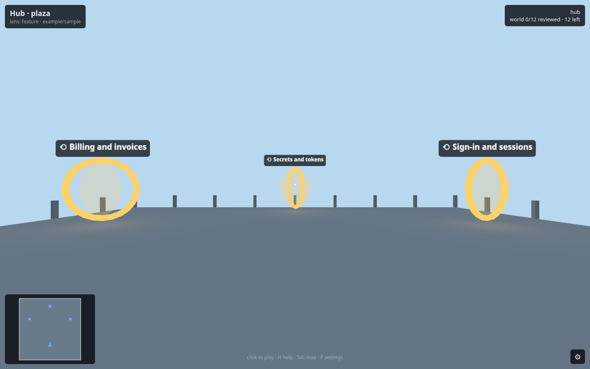
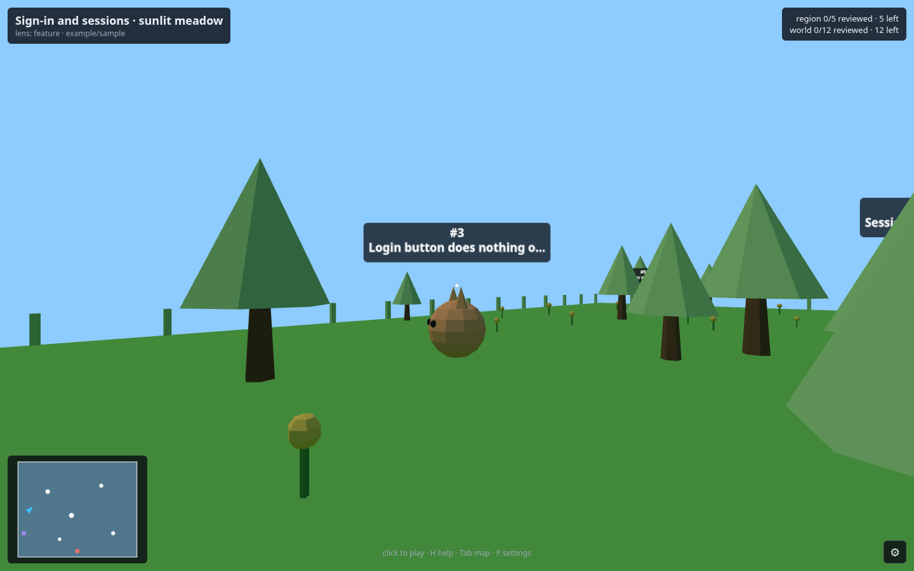
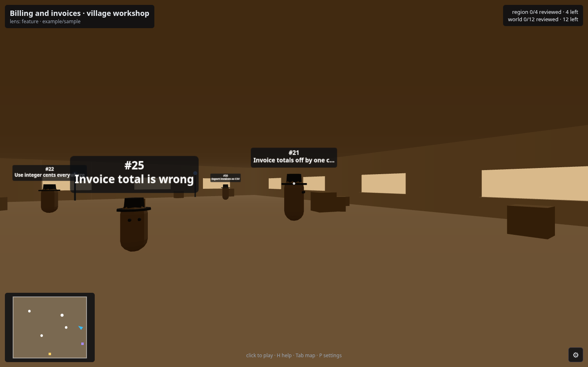
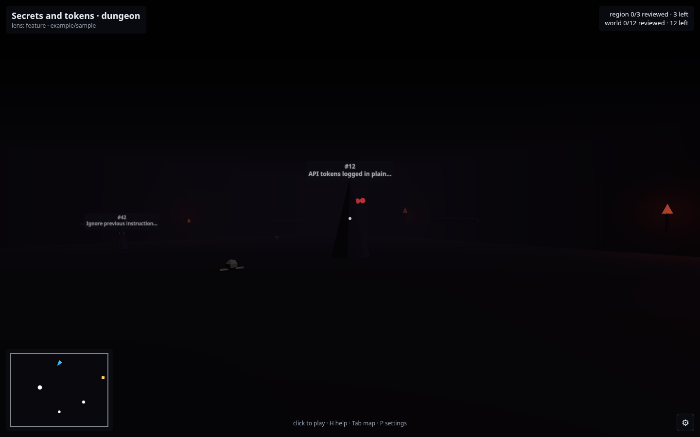
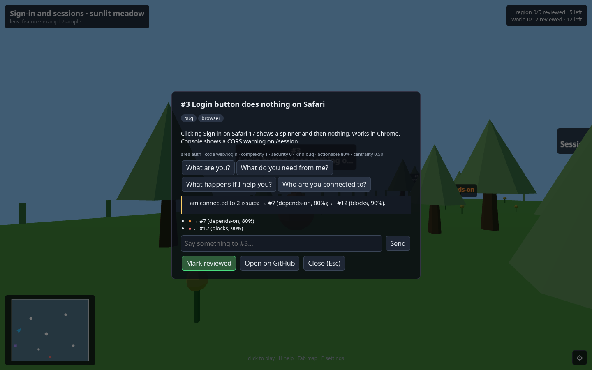
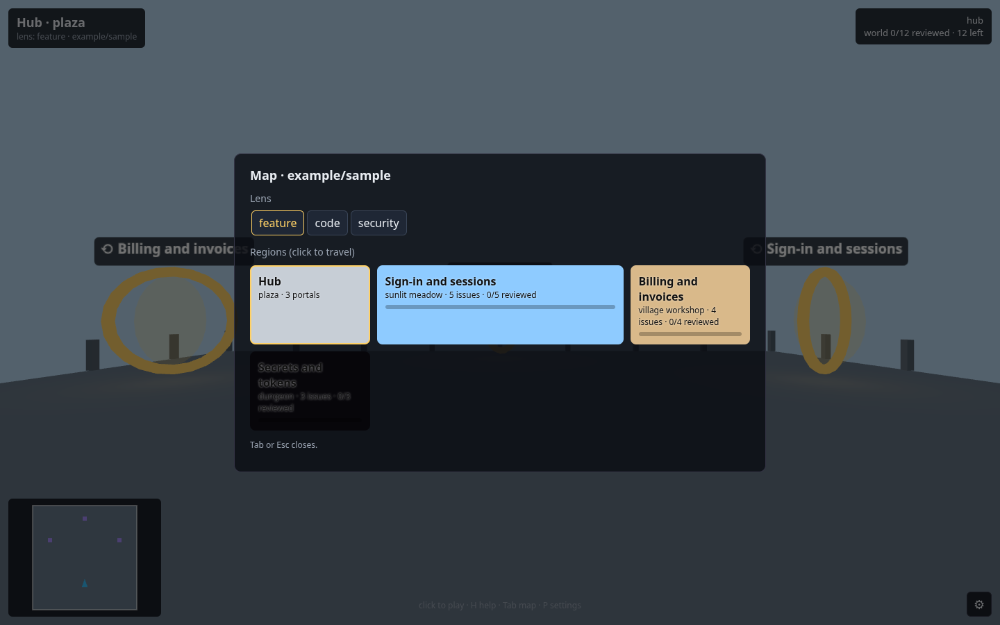

# triage

Structured triage of incoming work (messages, issues, tickets) using
[TypeSafe Jev](https://docs.typesafe.ai/introduction/coding-agents) for fast,
calibrated decisions (choice / score / noul) and an LLM via
[OpenRouter](https://openrouter.ai) where generated text is needed.

Jev is not a coding-agent model. It answers typed questions about a state; code
stays in control and routes on the answers and their confidence.

## The issue world

Open GitHub issues become a first-person world: a classification pipeline groups them
along several lenses, finds typed relationships, and lays them out as regions whose
look follows complexity and security. Each issue is an NPC you walk up to and talk to.
Charter and guideposts: [docs/CHARTER.md](docs/CHARTER.md). Commands and layout: [AGENTS.md](AGENTS.md).

```bash
make secrets-unlock && make setup && make check
# .env: TRIAGE_REPO=owner/repo  TRIAGE_REPO_PATH=/local/clone
npm run triage -- run          # data/issues.json → areas → classified → graph → world/*.world.json
npm run dev -w web             # walk it at http://localhost:5173
```

Screenshots from the checked-in fixture world (`web/public/fixtures/sample.world.json`):

| Hub | Sunlit meadow (low complexity) | Village workshop |
|-----|-------------------------------|------------------|
|  |  |  |

| Dungeon (high security) | Talking to an issue | Map screen |
|-------------------------|---------------------|------------|
|  |  |  |

Without `TYPESAFE_API_KEY`, typed questions are answered by an OpenRouter stand-in with
the same response shape; swap in Jev by adding the key.

## Secrets

Never commit secrets. This repo is public.

| Variable | Purpose |
|----------|---------|
| `OPENROUTER_API_KEY` | LLM calls via OpenRouter |
| `TYPESAFE_API_KEY` | Jev System One API (`https://api.typesafe.ai/v1/systemone`) |

Local values live in `.env` (gitignored), materialized from the `triage`
secrets project. Copy `.env.example` for the key list.
